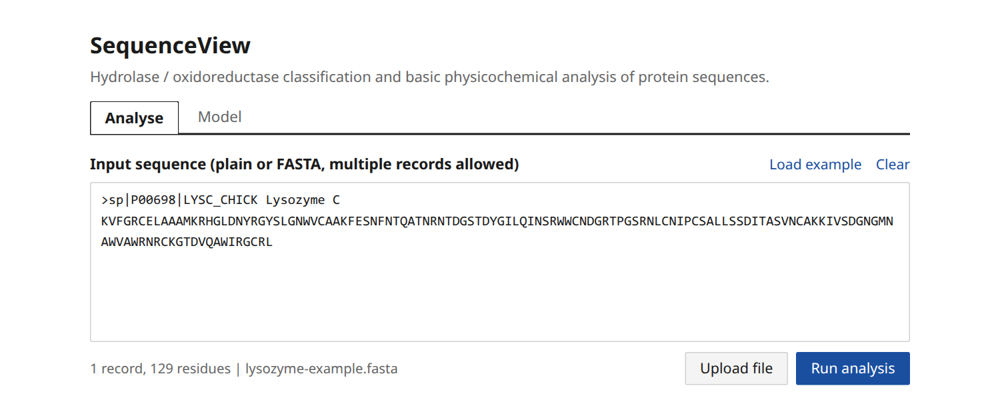
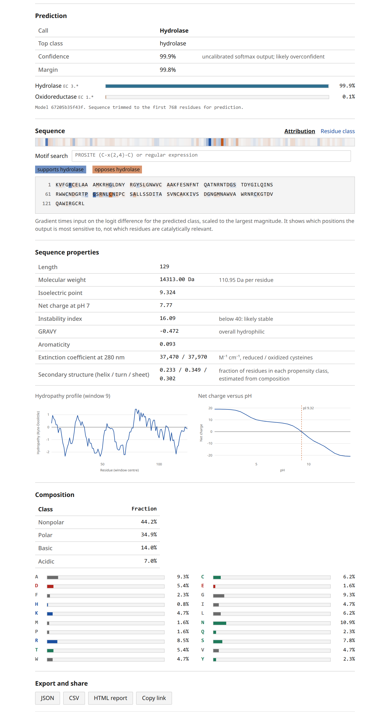
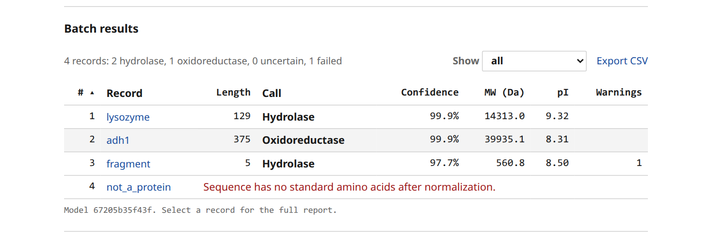

# SequenceView: Neural-Network Protein Sequence Analysis

## Overview

SequenceView is a full-stack bioinformatics app that analyses and classifies protein sequences. It combines a custom-trained PyTorch Bidirectional GRU (BiGRU) model for function predictions (Hydrolase EC 3.* vs Oxidoreductase EC 1.*) with a React frontend.





## Features

- Hydrolase (EC 3.*) versus oxidoreductase (EC 1.*) classification with a PyTorch BiGRU trained on reviewed UniProt entries.
- Multi-record FASTA input. Each record is classified separately and listed in a sortable, filterable table that can be exported to CSV.
- Per-residue attribution (gradient times input) shown as a heat strip and as shading on the sequence.
- Temperature-scaled confidence, with warnings for sequences outside the training length range, truncation at the model's maximum length, and non-standard residues.
- Biopython analysis: molecular weight, isoelectric point, net charge at pH 7, GRAVY, instability index, aromaticity, extinction coefficient and secondary-structure propensity fractions, plus hydropathy and charge-versus-pH plots.
- Motif search with PROSITE syntax or regular expressions, highlighted on the sequence, plus an automatic scan against a bundled library of 21 PROSITE signatures and two structural heuristics, compared with the model's call.
- Predicted 3D structure from the AlphaFold Database (looked up by UniProt accession), coloured by attribution, pLDDT, hydropathy or residue class, with a contact map that overlays the model's attribution.
- In-silico mutation scan: a heat map of how every single substitution in a region shifts the classifier's output, with a per-position sensitivity profile.
- Estimated secondary-structure ribbon (Chou-Fasman propensities) and a helical wheel with hydrophobic moment.
- Batch embedding map: a PCA projection of the classifier's pooled features for every record in a multi-FASTA.
- Pairwise alignment of two sequences (BLOSUM62) alongside both predictions and the change in probability.
- A Model tab with the checkpoint hash, training counts, held-out test metrics, confusion matrix and calibration figures.
- Exports as JSON, CSV or a standalone HTML report, and shareable links that restore the input.

## Model

This repository is centered on a single Google Colab notebook: [colab_training.ipynb](colab_training.ipynb).

It trains a PyTorch sequence classifier on UniProt amino acid sequences for a narrower binary task:

- `oxidoreductase` (EC 1.*)
- `hydrolase` (EC 3.*)

## Backend

This project includes a Flask backend in [src/sequenceview/app.py](src/sequenceview/app.py) that:

1. Accepts a user-provided protein sequence.
2. Uses Biopython to parse/analyze it (molecular weight, amino acid frequency, and related protein properties).
3. Runs inference with the trained PyTorch classifier.
4. Returns analysis + prediction JSON for frontend consumption.

### Backend Files

- [src/sequenceview/app.py](src/sequenceview/app.py): Flask app and HTTP routes.
- [src/sequenceview/sequence_analysis.py](src/sequenceview/sequence_analysis.py): Biopython parsing and sequence statistics.
- [src/sequenceview/model.py](src/sequenceview/model.py): Model architecture, checkpoint loader, and prediction service.

### Install

```bash
pip install -r requirements.txt
```

### Checkpoint Setup

The API expects a trained checkpoint generated by the notebook (`protein_classifier.pt`).

Set the checkpoint path with:

```bash
export SEQUENCEVIEW_CHECKPOINT_PATH=/absolute/path/to/protein_classifier.pt
```

If omitted, the backend defaults to `protein_classifier.pt` in the project root.

### Run API

```bash
PYTHONPATH=src python -m sequenceview.app
```

The API starts on `http://localhost:5000`. Set `HOST` to change the bind address and `FLASK_DEBUG=1` to enable debug mode.

## Frontend (React)

A React dashboard is available in [frontend/](frontend/) for interactive sequence analysis and prediction.

### Run Frontend (Bun)

From the project root:

```bash
cd frontend
bun install
bun run dev
```

The frontend runs on `http://localhost:5173` and proxies `/api` requests to Flask at `http://localhost:5000`.

### Frontend Build

```bash
cd frontend
bun run build
```

After building, Flask also serves the frontend bundle at `http://localhost:5000/`.
You can override the bundle path with:

```bash
export SEQUENCEVIEW_FRONTEND_DIST=/absolute/path/to/frontend/dist
```

### Dashboard Exports

For a single record the dashboard can export:

- JSON (`sequenceview-<id>.json`) with the full API payload.
- CSV (`sequenceview-<id>.csv`) with the prediction, properties, warnings and amino-acid frequencies.
- A standalone HTML report with the model version and hash, prediction, properties and sequence.

Batch results export as a single CSV with one row per record. "Copy link" stores the input in the URL fragment (up to about 6,000 characters), so shared links are never sent to the server until opened.

### Endpoints

- `GET /health`
	- Returns API readiness and whether the checkpoint is loaded.

- `GET /api/model`
	- Returns the checkpoint version and SHA-256, maximum length, temperature, confidence threshold and the metadata stored by the notebook (training counts, test metrics, calibration).

- `POST /api/predict`
	- Request body: `{"sequence": "MVLSPADKTNVKAA"}`. Plain sequence or a single FASTA record. Input with more than one record is rejected; use the batch endpoint.
	- Response fields:
		- `input`: record id and sequence.
		- `analysis`: Biopython properties, amino acid counts and frequencies, hydropathy profile, charge curve.
		- `prediction`: `class_name`, `predicted_class`, `confidence`, `margin`, `probabilities`, `is_uncertain`, `calibrated`, `temperature`.
		- `attribution`: per-residue scores in [-1, 1] for the predicted class.
		- `warnings`: list of `{code, message}` for out-of-distribution input.
		- `motifs`: library signatures found in the sequence, with 0-based half-open match ranges and the class each is typically associated with.
		- `model`: version, checkpoint hash and training counts, included with every prediction.

- `POST /api/mutscan`
	- Request body: `{"sequence": "...", "start": 0, "end": 120}` (0-based, end exclusive; at most 250 residues). Returns the change in the oxidoreductase log-odds and probability for each of the 20 residues at each position, plus the baseline. Inputs are padded to the sequence length rather than the training length for speed, so values differ marginally from `/api/predict`. It describes the network's sensitivity, not enzyme activity.

- `POST /api/compare`
	- Request body: `{"a": "<one record>", "b": "<one record>"}`. Returns both predictions, a global BLOSUM62 alignment with identity and similarity, and the change in oxidoreductase probability. Up to 2000 residues each.

- `POST /api/predict/batch`
	- Request body: `{"sequence": "<multi-record FASTA>"}` or `{"records": [{"id": "a", "sequence": "..."}]}`. At most 500 records.
	- Returns `results`, one summary per record (call, confidence, probabilities, headline properties, warnings). A record that cannot be analysed has an `error` instead. Attribution is not computed in batch mode. With three or more scored records the response also includes `projection`, a two-component PCA of the pooled model features.

### Confidence Handling

- `prediction.class_name` is `uncertain` when confidence is below the threshold (default `0.70`, set with `SEQUENCEVIEW_CONFIDENCE_THRESHOLD`).
- `prediction.predicted_class` is always the top raw class.
- Probabilities are divided by the temperature stored in the checkpoint before the softmax. The notebook fits it on the validation split and records the test expected calibration error before and after. Checkpoints trained before this change have no temperature, so their probabilities are the raw softmax output and are likely overconfident.

### External requests

The only request the dashboard makes outside your machine is the optional structure lookup, which sends a UniProt accession to `alphafold.ebi.ac.uk` and downloads the model file. Sequences are never sent anywhere other than your own Flask server. The structure is AlphaFold's prediction for the UniProt reference sequence, so it is only matched to your input when the input is a contiguous part of that sequence.

### Tests

```bash
pip install -r requirements-dev.txt
python -m pytest
cd frontend && bun run test
```

The backend tests build a tiny random-weight checkpoint, so they do not need `protein_classifier.pt`. GitHub Actions runs both suites and the frontend build on pushes and pull requests.

## Training Workflow

Open [colab_training.ipynb](colab_training.ipynb) in Google Colab and run Cell 2 with GPU enabled.

The notebook does everything end-to-end:

1. Installs dependencies (`requests`, `torch`).
2. Downloads reviewed UniProt entries for both classes.
3. Caches data to `/content/uniprot_binary_dataset.jsonl`.
4. Splits data with a sequence-identity-aware strategy to reduce leakage.
5. Trains a BiGRU-based classifier with AMP, gradient clipping, and early stopping.
6. Evaluates on a held-out test split, including confusion matrix counts.
7. Fits a temperature on the validation split and records calibration error.
8. Saves a checkpoint to Google Drive (if mounted) or local Colab storage.

## Outputs

- Per-epoch metrics: `train_loss`, `train_accuracy`, `validation_loss`, `validation_accuracy`
- Final test metrics dictionary and calibration figures
- Saved checkpoint path (default: `/content/drive/MyDrive/protein_classifier.pt`)
- Example inference output for a short amino acid sequence

## Notes

- This is a baseline model for experimentation, not a production biology model.
- Labels are annotation-derived from UniProt queries and may include noise.
- If you change class counts or split parameters, rerun the training cell to regenerate cache and metrics.
